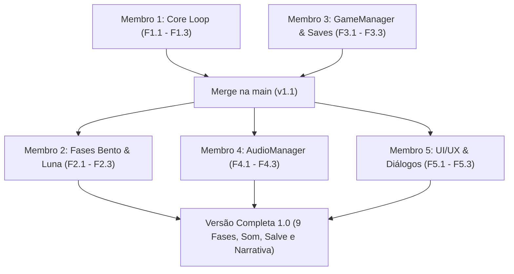

# 🚀 Planejamento de Integração da Equipe via GitHub: CatCode (5 Membros)

> **Projeto:** CatCode — Jogo Educativo de Lógica de Programação com Temática de Cuidado Animal  
> **Instituição:** Universidade Estadual do Ceará (UECE) — Extensão II / Projeto GABA  
> **Motor:** Godot Engine 4.x (GDScript)  
> **Repositório:** `marviniciuss/CatCode` (GitHub)  
> **Equipe:** 5 Integrantes  

---

## 1. Diagnóstico do Projeto: O Que Já Temos vs. O Que Falta

### 1.1. O que já está implementado e validado ✅
- **Núcleo de Gameplay da Fase 1 (`main.tscn` / `main.gd`):** Máquina de execução dos comandos sequenciais, realce do passo atual, modais pedagógicos de sucesso e falha, e ajuste de velocidade (0.5x, 1x, 2x).
- **Robô Programável (`robot.tscn` / `robot.gd`):** Movimentação em grade 2D, animações tween (passo, rotação 90°, esbarrão/bump em limites/arbustos), coleta e entrega de itens.
- **Tabuleiro & Entidades (`board.tscn` / `board.gd`, `cat_target.tscn`):** Grade top-down com linhas visuais, obstáculos (arbustos), tiles decorativos (pedra), item de ração com animação pulsante e gatinha Mia com respiração idle e reação ao ser alimentada.
- **Interface Visual da IDE (`hud.tscn`, `palette_button.gd`, `command_item.gd`):** Divisão em duas colunas (Mundo na esquerda, IDE à direita), paleta de comandos, lista de instruções montadas com numeração e exclusão.
- **Menús Iniciais (`start_menu.tscn`, `level_select.tscn`):** Tela de Início com "Como Jogar" e mapa de seleção com 9 botões de fase.
- **Dados do Cenário 1 (`level_data.gd`):** Fases 1, 2 e 3 estruturadas.
- **Testes Automatizados Headless (`test/`):** Validação de ponta a ponta sem necessidade de interface manual.

### 1.2. O que falta ser implementado para a versão completa 🎯
1. **Estrutura de Repetição (`LOOP`):** O botão existe na paleta, mas o interpretador ainda não executa sub-blocos ou contadores de repetição.
2. **Cenário 2 (Bento - Cãozinho) e Cenário 3 (Luna - Gata Enferma):** Criar e balancear as Fases 4 a 9 com novos itens (água, remédios) e desafios adequados para loop.
3. **Persistência de Dados e Sistema de Fases (`GameManager` / `SaveSystem`):** Desbloqueio progressivo de fases no mapa, sistema de 1 a 3 estrelas e passagem dinâmica de fase selecionada.
4. **Sistema de Áudio Completo (`AudioManager`):** SFX de cliques, passos, giros, coleta, miados, latidos, colisão e vitória, além de música ambiente relaxante.
5. **Polimento de UI/UX e Narrativa GABA:** Reordenação de blocos na lista (subir/descer), balões de história/diálogo introduzindo o animal acolhido e menu de pausa.

---

## 2. Dinâmica de Versionamento e Integração via GitHub

Para evitar os temidos **conflitos de merge em arquivos `.tscn` do Godot**, a equipe trabalhará com **Isolamento de Responsabilidade por Módulos**. Cada membro editará arquivos e cenas distintos.

### 2.1. Regras Fundamentais de Convivência no Git & Godot
1. **A branch `main` é sagrada:** Ninguém comita diretamente na `main`. Todo código entra via **Pull Request (PR)** revisado.
2. **Nunca commitar a pasta `.godot/`:** Ela já está no `.gitignore`. Cada desenvolvedor gera sua pasta `.godot/` local ao abrir a engine.
3. **Sincronização diária:** Sempre atualize sua branch com a `main` antes de iniciar o trabalho:
   ```bash
   git checkout main
   git pull origin main
   git checkout feature/sua-branch
   git merge main
   ```
4. **Feche o Godot antes de fazer merge/pull no Git:** Isso evita que o editor sobrescreva arquivos abertos na memória.

---

## 3. Divisão de Trabalho: 5 Membros, 5 Branches, 15 Features

Cada membro assumirá **1 branch temática**, contendo **3 features bem definidas**:

```
                                      ┌─── [Membro 1] feature/core-loop-executor (3 features)
                                      ├─── [Membro 2] feature/scenarios-bento-luna (3 features)
[main] (Estável) ◄─── (Pull Requests) ┼─── [Membro 3] feature/progression-save-system (3 features)
                                      ├─── [Membro 4] feature/audio-system (3 features)
                                      └─── [Membro 5] feature/ui-ux-dialogs (3 features)
```

---

### 👤 Membro 1: Core Engine & Interpretador de Loops
- **Branch:** `feature/core-loop-executor`
- **Responsabilidade:** Lógica algorítmica profunda, execução da repetição e robustez do interpretador.
- **Arquivos sob sua tutela:** `scripts/core/command_types.gd`, `scenes/main/main.gd`, `test/test_loop_execution.gd`.
- **Quantidade de Features:** 3 Features

| ID | Feature | Descrição e Critério de Aceite |
| :--- | :--- | :--- |
| **F1.1** | **Mecânica do Bloco `LOOP` no Interpretador** | Adaptar o executor em `main.gd` para suportar o comando `LOOP`. Permitir definir repetição de blocos subsequentes $N$ vezes (ex: repetir 3 vezes) ou bloco abre/fecha de repetição. |
| **F1.2** | **Feedback Visual e Prevenção de Loop Infinito** | Realçar a instrução de Loop na IDE durante a execução de cada ciclo e implementar trava de segurança pedagógica (limite de iterações para evitar travamentos). |
| **F1.3** | **Suíte de Testes Automatizados para Loops** | Criar script de teste headless em `test/test_loop_execution.gd` validando a resolução de um trajeto repetitivo pelo robô via código. |

---

### 👤 Membro 2: Level Design & Curadoria Pedagógica (Bento e Luna)
- **Branch:** `feature/scenarios-bento-luna`
- **Responsabilidade:** Criação das fases 4 a 9, balanceamento de dificuldade, inserção dos novos animais e itens de cuidado.
- **Arquivos sob sua tutela:** `scripts/core/level_data.gd`, `scenes/board/board.gd`, `scenes/entities/cat_target.gd`.
- **Quantidade de Features:** 3 Features

| ID | Feature | Descrição e Critério de Aceite |
| :--- | :--- | :--- |
| **F2.1** | **Cenário 2: O Cãozinho Bento (Fases 4, 5 e 6)** | Cadastrar em `level_data.gd` as fases do Bento. Planejar trajetos longos com obstáculos de caixas (`box_1.png`), incentivando o uso do `LOOP`, com a tigela de água fresca (`bowl_water.png`) como item. |
| **F2.2** | **Cenário 3: A Gatinha Luna na Enfermaria (Fases 7, 8 e 9)** | Cadastrar em `level_data.gd` as fases da enfermaria. Adicionar desafios com múltiplos passos lógicos (levar água e medicação/atendimento à gatinha Luna). |
| **F2.3** | **Suporte a Múltiplos Itens e Visual de Bento/Luna** | Atualizar `board.gd` para alternar o sprite do item (ração vs. água vs. remédio) conforme a fase e garantir que `CatTarget` carregue a arte do Bento (cãozinho) e Luna (gata enferma). |

---

### 👤 Membro 3: Arquitetura de Progresso & Persistência (Saves e Fases)
- **Branch:** `feature/progression-save-system`
- **Responsabilidade:** Gerenciador global do jogo, desbloqueio de níveis no mapa e salvamento persistente.
- **Arquivos sob sua tutela:** `scripts/core/game_manager.gd` (Autoload), `scenes/menus/level_select.tscn`, `scenes/menus/level_select.gd`.
- **Quantidade de Features:** 3 Features

| ID | Feature | Descrição e Critério de Aceite |
| :--- | :--- | :--- |
| **F3.1** | **Autoload `GameManager` (Estado Global)** | Criar singleton `game_manager.gd` configurado como Autoload no Godot. Conectar a seleção da fase no `level_select.gd` para carregar dinamicamente a fase correspondente no `main.gd`. |
| **F3.2** | **Sistema de Salvamento Local (`SaveSystem`)** | Criar rotina para salvar e carregar o progresso do jogador em `user://save_data.json` (fases desbloqueadas, estrelas conquistadas, fase atual). |
| **F3.3** | **Mapa de Fases Dinâmico (Cadeados e Estrelas)** | Atualizar `level_select.tscn` para exibir ícone de cadeado em fases bloqueadas e desenhar de 1 a 3 estrelas nas fases concluídas com base no número de blocos utilizados. |

---

### 👤 Membro 4: Sonoplastia & Feedback Sensorial (`AudioManager`)
- **Branch:** `feature/audio-system`
- **Responsabilidade:** Sonorização completa do jogo (SFX e música de fundo), controles de áudio e feedback auditivo pedagógico.
- **Arquivos sob sua tutela:** `scripts/core/audio_manager.gd` (Autoload), `assets/audio/`, gatilhos de áudio em `robot.gd`, `board.gd` e `hud.gd`.
- **Quantidade de Features:** 3 Features

| ID | Feature | Descrição e Critério de Aceite |
| :--- | :--- | :--- |
| **F4.1** | **Autoload `AudioManager` (Gerenciador de Áudio)** | Criar singleton com barramentos (Buses) de Áudio no Godot: canal `BGM` (Música) e canal `SFX` (Efeitos sonoros com múltiplos reprodutores para não cortar sons). |
| **F4.2** | **Implementação e Disparo dos Efeitos Sonoros (SFX)** | Importar áudios livres e conectar sinais: clique de bloco na IDE, remoção de bloco, passos/giro do robô, coleta de ração, miado/latido de agradecimento, batida em obstáculo e fanfarra de vitória. |
| **F4.3** | **Trilha Sonora Relaxante & Botão Mudo/Volume** | Adicionar música ambiente suave que estimula a concentração infantil e botão de ligar/desligar áudio na HUD e no Menu Iniciar. |

---

### 👤 Membro 5: UI/UX Specialist & Narrativa Pedagógica (IDE e Diálogos)
- **Branch:** `feature/ui-ux-dialogs`
- **Responsabilidade:** Experiência do usuário na IDE, reordenação de blocos, balões de história/diálogo do GABA e menu de pausa.
- **Arquivos sob sua tutela:** `scenes/ui/hud.tscn`, `scenes/ui/hud.gd`, `scenes/ui/command_item.tscn`, `scenes/ui/dialog_popup.tscn` (nova cena).
- **Quantidade de Features:** 3 Features

| ID | Feature | Descrição e Critério de Aceite |
| :--- | :--- | :--- |
| **F5.1** | **Reordenação de Blocos na IDE (Subir/Descer)** | Adicionar pequenos botões de seta para cima e para baixo em cada bloco (`command_item.tscn`), permitindo reposicionar instruções sem ter que apagar toda a lista de comandos. |
| **F5.2** | **Balões de Diálogo / Narrativa Pedagógica GABA** | Criar modal/balão de introdução (`dialog_popup.tscn`) antes do início da fase, contextualizando a história do resgate da Mia, do Bento e da Luna na ONG da UECE. |
| **F5.3** | **Menu de Pausa & Polimento de Telas de Vitória** | Implementar menu de pausa durante a fase (ESC ou botão de engrenagem) com opções de Retomar, Reiniciar e Voltar ao Mapa, além de adicionar animação comemorativa de estrelas no modal de vitória. |

---

## 4. Ordem Recomendada de Integração (Roadmap de Merges)

Para que o trabalho flua sem bloqueios técnicos, os Pull Requests devem ser mesclados na seguinte ordem cronológica:



1. **Onda 1 (Fundação de Sistema e Execução):**
   - **Membro 1** (`core-loop-executor`) e **Membro 3** (`progression-save-system`) abrem os primeiros PRs. Com o interpretador de loop pronto e o `GameManager` configurado, a base está pronta para receber novos níveis.
2. **Onda 2 (Conteúdo e Experiência Sensorial):**
   - **Membro 2** adiciona as fases 4 a 9 já usando a mecânica do Loop e o `GameManager`.
   - **Membro 4** conecta os efeitos sonoros nas ações prontas do Robô e da HUD.
   - **Membro 5** conecta os diálogos de história e melhora a usabilidade da lista de comandos.

---

## 5. Guia Rápido de Comandos Git para a Equipe

### Para iniciar o seu trabalho:
```bash
# 1. Clonar o repositório (apenas na primeira vez):
git clone https://github.com/marviniciuss/CatCode.git

# 2. Entrar na pasta e garantir que está na main:
cd CatCode
git checkout main
git pull origin main

# 3. Criar a sua branch designada:
git checkout -b feature/nome-da-sua-branch
```

### Durante o desenvolvimento diário:
```bash
# 1. Ver arquivos alterados:
git status

# 2. Adicionar alterações e comitar:
git add .
git commit -m "feat(modulo): breve descricao da feature implementada"

# 3. Enviar para o GitHub:
git push -u origin feature/nome-da-sua-branch
```

### Abrindo o Pull Request (PR):
1. Acesse o GitHub no repositório `marviniciuss/CatCode`.
2. Clique no aviso amarelo **"Compare & pull request"**.
3. No título, indique: `[Feature] Nome da Tarefa (Membro X)`.
4. Na descrição, marque as features testadas e anexe prints ou informe que rodou os testes do Godot.
5. Solicite a aprovação de pelo menos 1 colega da equipe antes de fazer o merge.
